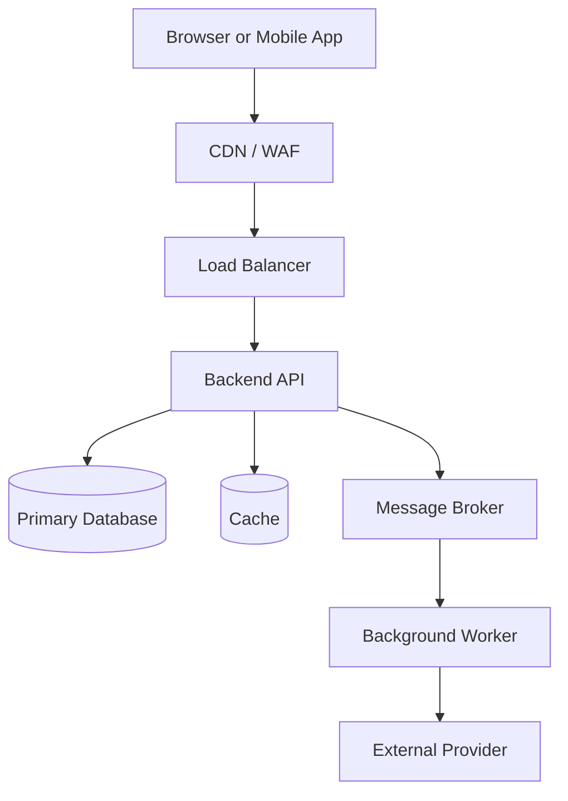
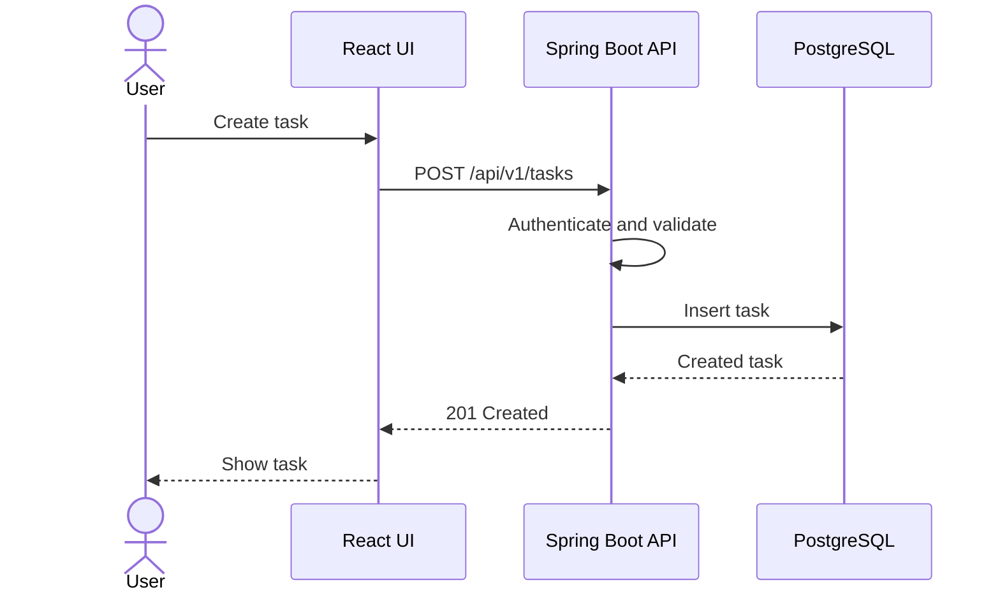
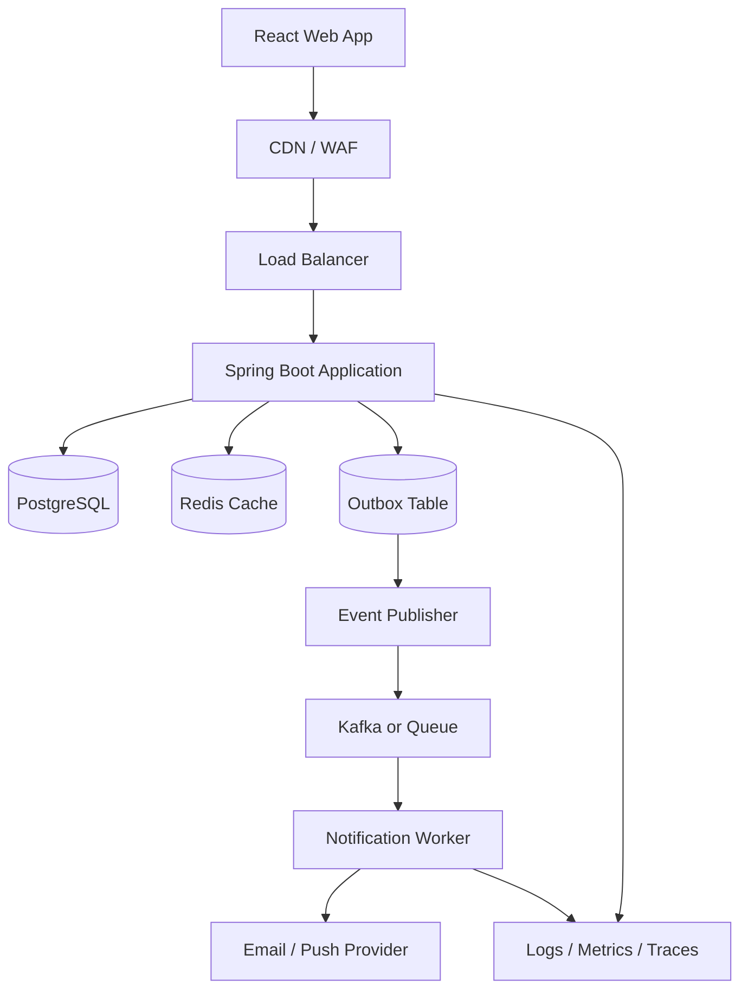
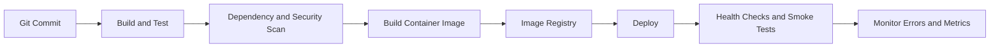
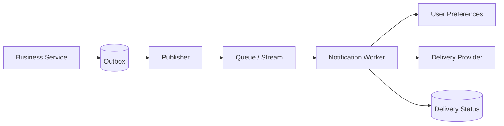

from pathlib import Path

content = r'''# System Design Complete Guide
## Beginner to Advanced — HLD, LLD, Architecture, Scalability, Security, Deployment, and Interviews

> **Purpose:** A practical, copy-ready reference for learning system design and preparing for software engineering interviews.
>
> **Suggested practice stack:** React, Java, Spring Boot, PostgreSQL, Redis, Kafka, Docker, and a cloud platform.
>
> **Important:** There is no universally correct architecture. Choose components based on requirements, constraints, traffic, correctness needs, team capability, and operational cost.

---

## Table of Contents

1. [What Is System Design?](#1-what-is-system-design)
2. [Requirements and Trade-offs](#2-requirements-and-trade-offs)
3. [Core Metrics and Capacity Estimation](#3-core-metrics-and-capacity-estimation)
4. [Networking and Web Fundamentals](#4-networking-and-web-fundamentals)
5. [API Design](#5-api-design)
6. [Architecture Styles](#6-architecture-styles)
7. [Load Balancing and Scaling](#7-load-balancing-and-scaling)
8. [Database Fundamentals](#8-database-fundamentals)
9. [Database Scaling and Data Modeling](#9-database-scaling-and-data-modeling)
10. [Caching and Redis](#10-caching-and-redis)
11. [Queues, Kafka, and Event-Driven Architecture](#11-queues-kafka-and-event-driven-architecture)
12. [Distributed Systems](#12-distributed-systems)
13. [Concurrency and Consistency](#13-concurrency-and-consistency)
14. [Security](#14-security)
15. [Low-Level Design (LLD)](#15-low-level-design-lld)
16. [High-Level Design (HLD)](#16-high-level-design-hld)
17. [Reliability and Resilience](#17-reliability-and-resilience)
18. [Observability and Operations](#18-observability-and-operations)
19. [Deployment and Infrastructure](#19-deployment-and-infrastructure)
20. [Frontend System Design](#20-frontend-system-design)
21. [System Design Case Studies](#21-system-design-case-studies)
22. [Interview Questions and Answers](#22-interview-questions-and-answers)
23. [Six-Week Study Plan](#23-six-week-study-plan)
24. [Practice Project: TESTFlow](#24-practice-project-testflow)
25. [Design Checklists](#25-design-checklists)
26. [Glossary](#26-glossary)
27. [Learning Resources](#27-learning-resources)

---

# 1. What Is System Design?

System design is the process of deciding how software components, data stores, APIs, infrastructure, and operational processes work together to meet a set of requirements.

A good design explains:
- What the system must do.
- What quality attributes it must achieve.
- How components communicate.
- Where data lives and how it is accessed.
- How the system behaves as load increases.
- What happens when dependencies fail.
- How security, deployment, monitoring, and recovery work.
- What trade-offs the design makes.

## 1.1 High-Level Design (HLD) vs Low-Level Design (LLD)

| HLD | LLD |
|---|---|
| Overall architecture and major components | Classes, interfaces, methods, and object interactions |
| Services, databases, queues, APIs, networks | OOP, SOLID, patterns, state, and code structure |
| Scalability, availability, latency, failure domains | Cohesion, coupling, extensibility, testability |
| Architecture, component, and deployment diagrams | Class, sequence, and state diagrams |
| Example: design a notification platform | Example: design notification channels and retry policies |

HLD and LLD connect. HLD chooses a notification service and queue; LLD determines the interfaces, templates, retry policy, and provider adapters.

## 1.2 Typical architecture



This is a teaching diagram, not a mandatory design. A small product may only need one backend application and one database.

## 1.3 Architecture decision principle

Prefer the simplest architecture that satisfies the requirements and can evolve safely. Every additional component introduces configuration, monitoring, deployment, failure handling, and cost.

---

# 2. Requirements and Trade-offs

## 2.1 Functional requirements

Functional requirements describe what users can do.

Example: a task management system:
- Sign up and sign in.
- Create workspaces and projects.
- Create, assign, update, and complete tasks.
- Comment on tasks.
- Search and filter tasks.
- View activity history.
- Receive notifications.
- Enforce workspace and project permissions.

## 2.2 Non-functional requirements (NFRs)

NFRs describe how well the system must operate.

- **Latency:** Time to complete an operation.
- **Throughput:** Work completed per unit of time.
- **Availability:** How often the service is usable.
- **Durability:** Whether committed data survives covered failures.
- **Consistency:** When readers observe updates.
- **Scalability:** Ability to handle growth.
- **Security:** Protection of data and actions.
- **Maintainability:** Ease of safely changing the system.
- **Observability:** Ability to understand system behavior.
- **Cost:** Infrastructure and operational expenditure.

Turn vague goals into measurable targets. “Fast” is vague; “95% of normal read requests finish within 250 ms at expected load” is testable.

## 2.3 Requirements questions for an interview

Ask:
1. Who are the users and what are the main use cases?
2. Which features are essential and which are out of scope?
3. How many daily and concurrent users are expected?
4. What are the read/write ratios and peak traffic?
5. What latency and availability targets matter?
6. Can data be eventually consistent?
7. What data must never be lost?
8. What are the retention, privacy, and security requirements?
9. What budget and team constraints exist?

## 2.4 Trade-offs

Most design choices trade one property for another:
- Latency vs consistency.
- Availability vs strict coordination during failures.
- Read performance vs write complexity.
- Simplicity vs independent scaling.
- Freshness vs caching.
- Redundancy vs cost.
- Strong validation vs request throughput.

State the reason for a choice, the downside, and when you would revisit it.

---

# 3. Core Metrics and Capacity Estimation

## 3.1 Metrics

- **Latency:** Duration of an operation.
- **Throughput:** Operations per second.
- **RPS:** HTTP requests per second.
- **Bandwidth:** Bytes transferred per second.
- **Concurrency:** Number of operations in progress.
- **Availability:** Fraction of time a service is usable.
- **Error rate:** Failed requests divided by total requests.
- **Saturation:** How close a resource is to its capacity.
- **p50/p95/p99:** Latency percentiles.

Averages can hide slow requests. p95 is the latency below which approximately 95% of measured requests complete.

## 3.2 Availability and downtime

Approximate downtime over a 30-day month:

| Availability | Downtime |
|---|---:|
| 99% | 7 h 12 min |
| 99.9% | 43 min 12 sec |
| 99.99% | 4 min 19 sec |

Higher availability generally requires redundancy, careful releases, monitoring, and tested recovery procedures.

## 3.3 Request-volume example

Assume:
- 100,000 daily active users.
- 40 API requests per user per day.
- Traffic averaged over 86,400 seconds per day.

```text
Daily requests = 100,000 × 40 = 4,000,000
Average RPS = 4,000,000 / 86,400 ≈ 46.3
If peak = 5 × average, peak RPS ≈ 232
```

This is an estimate. Real traffic can be bursty, and background jobs may create additional load.

## 3.4 Storage estimate

Assume 2 million new records monthly, averaging 2 KB each before index and replication overhead:

```text
2,000,000 × 2 KB ≈ 4 GB/month (decimal approximation)
```

Then add index overhead, backups, replicas, retention, attachments, and expected growth.

## 3.5 Bandwidth estimate

If 200 requests per second each return an average of 50 KB:

```text
200 × 50 KB = 10,000 KB/s ≈ 10 MB/s
```

This excludes request bodies, protocol overhead, retransmission, and other traffic.

## 3.6 Little's Law

For a stable system:

```text
Average concurrency = throughput × average time in system
```

At 200 requests/second and 0.25 seconds average time:

```text
Average in-flight requests ≈ 200 × 0.25 = 50
```

This is not a direct server-count formula; load tests and resource measurements are still required.

---

# 4. Networking and Web Fundamentals

## 4.1 What happens during an API request?

A simplified flow:
1. The browser resolves the domain using DNS.
2. It establishes a network connection; HTTPS uses TLS.
3. It sends an HTTP request.
4. A CDN, reverse proxy, gateway, or load balancer may receive it.
5. The application authenticates and validates the request.
6. The application reads or writes a cache, database, or downstream service.
7. The server returns an HTTP response.
8. The browser processes the response and updates the UI.

Actual details vary with HTTP version, connection reuse, caching, and infrastructure.

## 4.2 HTTP methods

| Method | Common use | Idempotent by intended effect? |
|---|---|---|
| GET | Read a resource | Yes |
| POST | Create or trigger an operation | Usually no |
| PUT | Replace a resource | Yes |
| PATCH | Partially update a resource | Not necessarily |
| DELETE | Delete a resource | Yes |

Idempotent means repeating the same operation has the same intended effect. A repeated DELETE may return a different status while still being idempotent in effect.

## 4.3 HTTP status codes

- `200 OK`: Success.
- `201 Created`: Resource created.
- `202 Accepted`: Work accepted for asynchronous processing.
- `204 No Content`: Success with no response body.
- `400 Bad Request`: Invalid request.
- `401 Unauthorized`: Authentication missing or invalid.
- `403 Forbidden`: Caller lacks permission.
- `404 Not Found`: Resource absent or intentionally concealed.
- `409 Conflict`: Conflict with current state.
- `422 Unprocessable Content`: Semantically invalid input (usage varies).
- `429 Too Many Requests`: Rate limit exceeded.
- `500 Internal Server Error`: Unexpected server failure.
- `502 Bad Gateway`: Invalid upstream response.
- `503 Service Unavailable`: Service temporarily unavailable.
- `504 Gateway Timeout`: Upstream timed out.

## 4.4 DNS, TLS, CDN, reverse proxy, gateway

- **DNS:** Resolves domain names to network records.
- **TLS:** Provides encrypted transport and server authentication for HTTPS.
- **CDN:** Caches and delivers eligible content from edge locations.
- **Reverse proxy:** Receives requests on behalf of backend servers.
- **Load balancer:** Distributes traffic across backend instances.
- **API gateway:** Commonly routes APIs and applies policies such as authentication integration and quotas.

These roles can overlap in real products.

## 4.5 REST, SSE, WebSockets, gRPC

- **REST/HTTP:** General request-response APIs.
- **SSE:** Server-to-browser one-way event stream.
- **WebSockets:** Persistent bidirectional communication, useful for chat and collaborative applications.
- **gRPC:** RPC framework commonly using Protocol Buffers and HTTP/2, useful for typed service-to-service communication.

Persistent connections require connection management, authorization, reconnection, and capacity planning.

---

# 5. API Design

## 5.1 Resource-oriented API examples

```http
GET    /api/v1/projects
POST   /api/v1/projects
GET    /api/v1/projects/42
PATCH  /api/v1/projects/42
DELETE /api/v1/projects/42

GET    /api/v1/projects/42/tasks?page=0&size=20
POST   /api/v1/projects/42/tasks
GET    /api/v1/tasks/900
PATCH  /api/v1/tasks/900
POST   /api/v1/tasks/900/comments
```

Use consistent names, predictable status codes, validation, and a standard error format.

## 5.2 Pagination

Offset pagination:

```http
GET /api/v1/tasks?page=0&size=20
```

Simple, but large offsets can be expensive and records may shift between pages as data changes.

Cursor pagination:

```http
GET /api/v1/tasks?limit=20&cursor=opaque-cursor
```

Often works better for large or frequently changing datasets. It requires a stable ordering and cursor logic.

Always impose a maximum page size.

## 5.3 Error response

A response inspired by the Problem Details convention:

```json
{
  "type": "https://example.com/problems/validation",
  "title": "Validation failed",
  "status": 400,
  "detail": "One or more fields are invalid.",
  "instance": "/api/v1/projects",
  "errors": {
    "name": "Name must not be blank"
  },
  "traceId": "abc123"
}
```

Never return stack traces, secrets, SQL details, or internal hostnames to clients.

## 5.4 Idempotency keys

For operations that must not be duplicated, a client can send:

```http
POST /api/v1/orders
Idempotency-Key: 6a61c0f5-6d9d-4b6d-9b72-7e6f1a4a13f0
```

The server records the key and the operation's result for a defined period. Repeated requests with the same key should not create duplicate effects. Define behavior when a key is reused with a different payload.

## 5.5 API versioning

Common strategies:
- URL path: `/api/v1/tasks`
- Header-based versioning.
- Backward-compatible additive changes.

Version when necessary; avoid breaking existing clients unexpectedly. Define deprecation and migration periods.

## 5.6 Rate limiting

Common algorithms:
- Fixed window.
- Sliding window.
- Token bucket.
- Leaky bucket.

A token bucket allows bursts up to a configured capacity while limiting the average rate. Return `429` when a caller exceeds the policy and optionally include retry guidance.

---

# 6. Architecture Styles

## 6.1 Monolith

A monolith is deployed as one unit, even if its code contains multiple modules.

**Pros:** Simple deployment, local debugging, and transactions; fewer network failure modes.

**Cons:** Poor module boundaries can create coupling; individual parts may be hard to scale independently.

## 6.2 Modular monolith

One deployable application with explicit business modules, such as Identity, Projects, Tasks, Notifications, and Reporting.

Often a good starting point: simpler operations than microservices, but better boundaries than an unstructured monolith.

## 6.3 Microservices

Independently deployable services organized around business capabilities.

**Benefits:** Independent scaling, release, and ownership.

**Costs:** Network failures, distributed tracing, data consistency, deployment complexity, service discovery, and higher operational overhead.

Do not choose microservices simply because a product might grow. Extract a service when independent scaling, ownership, isolation, or release needs justify it.

## 6.4 Layered architecture

Common backend layers:

```text
Controller / API
    ↓
Application Service
    ↓
Domain Logic
    ↓
Repository / Persistence
    ↓
Database
```

Responsibilities:
- **Controller:** HTTP input/output, request mapping.
- **Application service:** Use-case orchestration and transaction boundary.
- **Domain model:** Business rules and invariants.
- **Repository:** Persistence abstraction.
- **Infrastructure:** Database, message broker, email provider, and external clients.

Do not put all business logic in controllers.

## 6.5 Synchronous vs asynchronous communication

- Synchronous HTTP/gRPC: caller waits for the result.
- Asynchronous message/event: producer and consumer are decoupled in time.

Use synchronous calls when the result is immediately needed. Use asynchronous work for notifications, report generation, event distribution, and burst smoothing when eventual completion is acceptable.

---

# 7. Load Balancing and Scaling

## 7.1 Vertical vs horizontal scaling

- **Vertical:** Add CPU, memory, or storage to a machine. Simpler, but bounded and may leave a larger failure domain.
- **Horizontal:** Add instances. Offers capacity and potential resilience, but requires routing, health checks, and usually stateless services.

## 7.2 Load-balancing algorithms

- Round robin.
- Weighted round robin.
- Least connections.
- Consistent hashing.
- Random or power-of-two choices.

Selection depends on request duration, connection behavior, workload skew, and platform capabilities.

## 7.3 Stateless services

A stateless service instance does not rely on local memory or local disk to preserve user session state across requests. Shared durable state belongs in a database or suitable shared service.

Stateless instances are easier to replace and scale.

## 7.4 Health checks

- **Liveness:** Should this process be restarted?
- **Readiness:** Should it receive traffic?
- **Startup:** Has initialization finished?

A downstream dependency outage should not automatically cause every application instance to restart.

## 7.5 Autoscaling

Scale based on relevant signals such as CPU, memory, request concurrency, queue lag, or custom metrics. Scaling needs warm-up time, resource limits, and safeguards against oscillation. Autoscaling does not replace capacity planning.

---

# 8. Database Fundamentals

## 8.1 SQL vs NoSQL

| Relational SQL | NoSQL (multiple database categories) |
|---|---|
| Tables, constraints, joins, relational model | Document, key-value, graph, wide-column, and other models |
| Strong support for relational queries and transactions | Capabilities differ by product and data model |
| Good fit for many business workflows | Can fit specialized access patterns and scale requirements |

NoSQL is not automatically faster. Choose based on data shape, access patterns, correctness, operational skills, and measured performance.

## 8.2 ACID

- **Atomicity:** Transaction succeeds as a whole or has no effect.
- **Consistency:** Transactions preserve defined integrity rules.
- **Isolation:** Concurrent transactions obey the selected isolation guarantees.
- **Durability:** Committed data survives failures covered by the database's guarantees.

## 8.3 Normalization and schema example

```sql
CREATE TABLE app_user (
    id BIGINT GENERATED ALWAYS AS IDENTITY PRIMARY KEY,
    email TEXT NOT NULL UNIQUE,
    display_name TEXT NOT NULL,
    created_at TIMESTAMPTZ NOT NULL DEFAULT now()
);

CREATE TABLE project (
    id BIGINT GENERATED ALWAYS AS IDENTITY PRIMARY KEY,
    name TEXT NOT NULL,
    owner_id BIGINT NOT NULL REFERENCES app_user(id),
    created_at TIMESTAMPTZ NOT NULL DEFAULT now()
);

CREATE TABLE task (
    id BIGINT GENERATED ALWAYS AS IDENTITY PRIMARY KEY,
    project_id BIGINT NOT NULL REFERENCES project(id),
    title TEXT NOT NULL,
    status TEXT NOT NULL CHECK (
        status IN ('TODO', 'IN_PROGRESS', 'DONE')
    ),
    assignee_id BIGINT REFERENCES app_user(id),
    created_at TIMESTAMPTZ NOT NULL DEFAULT now()
);

CREATE INDEX idx_task_project_created
    ON task(project_id, created_at DESC);

CREATE INDEX idx_task_assignee
    ON task(assignee_id);
```

This is a starter schema. A real multi-tenant application may require membership tables, tenant constraints, audit records, status history, soft deletion, and stronger domain validation.

Normalization reduces duplication and update anomalies. Denormalization deliberately duplicates or precomputes data when measured read requirements justify the added consistency work.

## 8.4 Indexes

Indexes speed up some reads but consume storage and add write overhead. Build indexes around actual filter, join, and sort patterns. Use `EXPLAIN` and carefully selected `EXPLAIN ANALYZE` runs to inspect query plans.

Composite index column order matters. An index on `(project_id, created_at)` may support filtering by project and ordering by creation time, depending on the query and plan.

## 8.5 Transactions

Keep transactions as short as practical. Avoid holding database locks while waiting for a slow external network call. Use constraints to enforce important invariants at the database boundary as well as validating in application code.

---

# 9. Database Scaling and Data Modeling

## 9.1 Connection pooling

A connection pool reuses a bounded set of database connections. Spring Boot commonly uses HikariCP.

Estimate connection budgets:

```text
Maximum potential connections
≈ pool size per application instance × maximum instance count
```

Leave room for migrations, administration, monitoring, and other clients. Increasing pool size without considering database capacity can reduce performance.

## 9.2 Read replicas

A primary accepts writes and replicates data to read replicas.

**Benefits:** Offload read traffic and increase read capacity.

**Trade-offs:** Replication lag, routing complexity, and additional cost. Read-after-write operations may need the primary. Replicas are not a substitute for backups.

## 9.3 Partitioning vs sharding

- **Partitioning:** Split a table into logical parts, often by range, list, or hash. PostgreSQL supports declarative partitioning.
- **Sharding:** Distribute data across multiple database servers using a shard key.

Sharding complicates cross-shard queries, global uniqueness, transactions, rebalancing, and operations. Try query optimization, indexes, pooling, and replicas before sharding unless scale or isolation needs demand it.

## 9.4 Isolation levels

Common isolation levels:
- Read Uncommitted (PostgreSQL treats it as Read Committed).
- Read Committed.
- Repeatable Read.
- Serializable.

Stronger isolation can prevent more anomalies but may increase contention and transaction retries. Select based on correctness requirements and test concurrent workloads.

## 9.5 Optimistic locking

Use a version column to detect stale writes:

```sql
UPDATE task
SET title = :title,
    version = version + 1
WHERE id = :id
  AND version = :expected_version;
```

If no row updates, the record may have changed or disappeared. Return a suitable conflict response or retry only when safe.

## 9.6 Backups, RPO, and RTO

- **RPO:** Maximum tolerable data loss measured in time.
- **RTO:** Maximum tolerable recovery duration.

A recovery plan needs automated backups, retention, point-in-time recovery if required, replication/failover planning, documented restore procedures, and regular restore drills.

---

# 10. Caching and Redis

## 10.1 Why cache?

Caching can reduce response latency and database or external-service load. Suitable data is frequently read and can tolerate a defined staleness window.

Potential uses:
- Frequently read records.
- Computed results.
- Session or ephemeral state, when appropriate.
- Rate-limit counters.
- Temporary coordination data with carefully defined failure behavior.

## 10.2 Cache-aside pattern

1. Read cache.
2. If hit, return cached data.
3. If miss, query the database.
4. Store the result with a TTL.
5. Return the result.

Pseudocode:

```text
getTask(id):
    cached = cache.get("task:" + id)
    if cached exists:
        return cached

    task = database.findTask(id)
    if task exists:
        cache.set("task:" + id, task, TTL=5 minutes)
    return task
```

## 10.3 Cache strategies

- **Cache-aside:** Application explicitly reads and fills the cache.
- **Read-through:** Cache layer loads missing data through a loader.
- **Write-through:** Cache and backing store are updated as part of the write strategy.
- **Write-behind:** Cache accepts writes and persists them later; risk and recovery semantics must be carefully understood.

## 10.4 Invalidation and stale data

After updating a task, update or invalidate its cache entry. Related list caches and counters also matter. Race conditions can still occur; versioning, short TTLs, or stronger coordination may be needed for sensitive use cases.

## 10.5 Cache failure modes

- **Cache stampede:** Many callers recompute an expired key.
- **Hot key:** One key gets disproportionate traffic.
- **Cache penetration:** Repeated lookups for nonexistent values.
- **Stale data:** Cache returns an old value.
- **Eviction pressure:** Memory limits remove useful entries.

Mitigations include TTL jitter, request coalescing, stale-while-revalidate, negative caching with care, key distribution, and monitoring.

Redis is not automatically the source of truth. Decide how the app behaves when Redis is slow or unavailable, and protect the database from a sudden cache-fallback traffic surge.

---

# 11. Queues, Kafka, and Event-Driven Architecture

## 11.1 Why asynchronous processing?

Example: creating a task also sends an email. The API can save the task and enqueue a notification instead of waiting for the email provider.

Benefits:
- Faster user-facing response.
- Traffic smoothing.
- Independent consumer scaling.
- Reduced direct coupling.

Costs:
- Eventual consistency.
- Retries and duplicates.
- More operational work and debugging.

## 11.2 Queue vs event stream

A work queue commonly distributes jobs among workers. Kafka stores ordered records in topic partitions for a retention period, allowing consumer groups to process and replay records subject to retention and offset rules.

Choose based on required semantics, throughput, replay needs, ordering, delay/scheduling features, and operational experience.

## 11.3 Kafka concepts

- **Producer:** Publishes records.
- **Topic:** Named record stream.
- **Partition:** Ordered subset of a topic.
- **Offset:** Record position in a partition.
- **Consumer:** Reads records.
- **Consumer group:** Coordinates partition assignments across consumers.
- **Replication factor:** Number of copies of partition data.

Ordering is generally guaranteed within one partition, not across every partition. A key can route related events to the same partition.

## 11.4 Delivery semantics

- **At-most-once:** Processing path avoids redelivery but can lose work.
- **At-least-once:** Redelivery can happen; consumers should be idempotent.
- **Exactly-once:** Supported mechanisms can provide guarantees within defined boundaries. External side effects still require careful coordination.

Do not assume end-to-end exactly-once effects merely because the broker offers transactional features.

## 11.5 Retry and dead-letter design

- Retry transient errors with bounded exponential backoff and jitter.
- Do not endlessly retry permanent validation errors.
- After the retry policy, move failed work to a dead-letter or quarantine flow.
- Alert on queue lag and dead-letter growth.
- Make replay safe and auditable.

## 11.6 Transactional outbox

Problem: a database commit succeeds but event publication fails, or publication succeeds while the database transaction rolls back.

Pattern:
1. Write business data and an outbox record in the same database transaction.
2. A publisher reads pending outbox records.
3. Publish them to the broker.
4. Track delivery state.
5. Make consumers idempotent because duplicate publication may occur.

This avoids needing one atomic transaction across the database and broker.

---

# 12. Distributed Systems

## 12.1 CAP theorem

During a network partition, a distributed data system must trade off:
- **Consistency:** Reads observe data according to a single-copy consistency guarantee.
- **Availability:** Requests to non-failing nodes receive a response.
- **Partition tolerance:** The system continues despite communication failures between parts.

CAP is specifically about behavior during partitions; it does not mean every system simply chooses any two properties under all circumstances.

## 12.2 Strong vs eventual consistency

- **Strong consistency:** Reads after a successful write observe the latest committed value according to the system's consistency model.
- **Eventual consistency:** Replicas are expected to converge when updates stop and communication recovers.

Eventual consistency can fit counters, search indexes, analytics, and some feed updates. Financial transfers, unique reservations, and critical permission checks often need stronger correctness controls.

## 12.3 Sagas

A saga models a multi-step business operation as local transactions with compensating actions.

Example:
1. Reserve a seat.
2. Authorize payment.
3. Confirm booking.
4. If payment fails, release the seat.

Compensation is a business action, not always a perfect rollback. A refund cannot erase the fact that a payment was briefly captured.

## 12.4 Service discovery

Dynamic service instances change addresses. Service discovery or platform-native service names help locate healthy instances. Kubernetes Services provide stable names and routing to matching Pods.

## 12.5 Distributed locks

Distributed locks need lease expiration, failure handling, and protection against stale lock holders. If a database constraint, conditional update, or idempotency key can protect the invariant, it is often simpler than a distributed lock.

## 12.6 Clocks and ordering

Wall clocks can drift. Do not assume timestamps from separate machines provide a perfect global order. For important ordering, use database sequence/version values, partition ordering, or a domain-specific ordering strategy.

---

# 13. Concurrency and Consistency

## 13.1 Race conditions

A race condition occurs when results depend on the timing of concurrent operations.

Example: two users try to reserve the final seat. Both read `available = 1`, then both attempt to reserve it. A safe design must make the check and update atomic.

## 13.2 Conditional update

```sql
UPDATE inventory
SET available = available - 1
WHERE item_id = :item_id
  AND available > 0;
```

Check the affected-row count. A successful update means a unit was reserved; zero rows means the item was unavailable or missing. Use a transaction for related reservation records.

## 13.3 Lock types

- **Pessimistic locking:** Lock records to prevent competing updates.
- **Optimistic locking:** Allow concurrent work, then detect conflicts.
- **Mutex:** Enforces mutual exclusion in a defined synchronization domain.
- **Semaphore:** Limits concurrent access to a finite number of permits.

Locks can cause contention and deadlocks. Keep critical sections short and use consistent lock ordering.

## 13.4 Deadlocks

A deadlock occurs when operations wait on each other's locks in a cycle.

Mitigation:
- Acquire resources in a consistent order.
- Keep transactions short.
- Use indexes to avoid broad scans and unnecessary locks.
- Detect and retry aborted transactions only when the operation is safe to retry.

---

# 14. Security

## 14.1 Authentication vs authorization

- **Authentication:** Who are you?
- **Authorization:** What are you allowed to do?

A logged-in user should not automatically be able to read every project's tasks. Check permissions for the specific resource and tenant boundary.

## 14.2 Sessions vs JWT

**Server-side session**
- Browser stores a session identifier, commonly in a cookie.
- Server stores session state.
- Revocation is often straightforward, but session storage and scaling must be considered.

**JWT**
- Signed token carries claims.
- Services can validate it without looking up session state on every request if configured accordingly.
- Revocation, token lifetime, key rotation, and claim freshness need planning.

JWT is not automatically safer than sessions. Keep access tokens short-lived when appropriate, protect refresh tokens, and do not put secrets in a JWT payload.

## 14.3 OAuth 2.0 and OpenID Connect

- **OAuth 2.0:** Authorization framework for delegated access.
- **OpenID Connect (OIDC):** Identity layer built on OAuth 2.0.
- **Access token:** Used to access a protected resource.
- **ID token:** Provides authentication information to an OIDC client.
- **Refresh token:** Obtains new tokens under issuer policy.

Prefer established identity providers and libraries over a custom token protocol.

## 14.4 RBAC

Example roles:
- `ADMIN`: Manage workspace settings and membership.
- `MANAGER`: Manage projects and assignments within allowed workspaces.
- `MEMBER`: Work on accessible tasks.
- `VIEWER`: Read permitted project data.

Role checks may not be sufficient; resource ownership, tenant boundaries, and object-level permissions matter too.

## 14.5 Security checklist

- Validate and normalize input.
- Use parameterized SQL or safe ORM APIs.
- Hash passwords with an appropriate password-hashing algorithm and parameters.
- Use HTTPS.
- Keep secrets out of source control, images, and logs.
- Apply least privilege to services and database accounts.
- Configure CORS for known origins.
- Protect cookie-based sessions against CSRF where relevant.
- Rate-limit login, password reset, and expensive endpoints.
- Avoid leaking internal error details.
- Patch dependencies and scan container images.
- Audit sensitive actions.
- Use encryption in transit and suitable encryption at rest.
- Enforce authorization on every protected resource.

---

# 15. Low-Level Design (LLD)

## 15.1 SOLID

- **Single Responsibility:** One coherent reason for a module to change.
- **Open/Closed:** Extend behavior without repeatedly modifying stable code.
- **Liskov Substitution:** Implementations honor the contract expected by clients.
- **Interface Segregation:** Prefer focused interfaces over large interfaces with irrelevant methods.
- **Dependency Inversion:** High-level policy depends on abstractions, not concrete low-level details.

SOLID is guidance, not a requirement to add interfaces to every class.

## 15.2 Composition over inheritance

Composition assembles behavior from collaborators. Inheritance is useful when there is a genuine substitutable “is-a” relationship.

```java
public interface NotificationSender {
    void send(String recipient, String message);
}

public final class EmailSender implements NotificationSender {
    @Override
    public void send(String recipient, String message) {
        // Call the configured email provider.
    }
}

public final class NotificationService {
    private final NotificationSender sender;

    public NotificationService(NotificationSender sender) {
        this.sender = sender;
    }

    public void notify(String recipient, String message) {
        sender.send(recipient, message);
    }
}
```

The service can be tested with a fake sender and later use another channel without changing the orchestration.

## 15.3 Common design patterns

| Pattern | Purpose | Example |
|---|---|---|
| Strategy | Swap behavior | Email/SMS delivery |
| Factory | Centralize creation choices | Select parser by file type |
| Builder | Construct complex objects | Request configuration |
| Adapter | Bridge incompatible interfaces | Wrap a third-party provider |
| Decorator | Add behavior around an object | Metrics or logging wrapper |
| Observer / Pub-Sub | Notify subscribers | Domain events |
| Repository | Encapsulate persistence | `TaskRepository` |
| Dependency Injection | Supply collaborators externally | Spring beans |
| State | Behavior varies with state | Order lifecycle |
| Command | Represent an operation | Retryable job |

Use patterns only when they improve clarity or changeability.

## 15.4 UML diagrams

- Class diagram: classes, interfaces, and relationships.
- Sequence diagram: interactions over time.
- State diagram: states and transitions.
- Component diagram: modules and dependencies.
- Deployment diagram: runtime nodes and deployed components.

Example sequence:



## 15.5 LLD interview method

1. Clarify requirements and edge cases.
2. Identify entities and responsibilities.
3. Define public interfaces and operations.
4. Draw relationships and state transitions.
5. Apply SOLID when useful.
6. Handle validation, errors, concurrency, and persistence.
7. Write a small implementation or pseudocode.
8. Explain testing and future extension.

---

# 16. High-Level Design (HLD)

## 16.1 Standard interview framework

1. Clarify scope and assumptions.
2. Define functional and non-functional requirements.
3. Estimate users, RPS, data volume, and peak load.
4. Define APIs and events.
5. Model data, indexes, and access patterns.
6. Draw the simplest viable architecture.
7. Walk through the critical request path.
8. Identify bottlenecks.
9. Scale selectively using caching, replicas, queues, or partitions.
10. Cover failures, retries, recovery, and consistency.
11. Cover security and observability.
12. Explain trade-offs and alternatives.

Do not start by adding every technology you know.

## 16.2 Task management platform architecture



For a small application, start with React, one Spring Boot application, and PostgreSQL. Add Redis or asynchronous processing only when the requirements justify it.

## 16.3 Component selection guide

| Requirement | Candidate | Trade-off |
|---|---|---|
| Relational business data | PostgreSQL | Query and schema design matter |
| Frequently read stable values | Redis cache | Invalidation and cache failures |
| Background jobs | Queue and worker | Eventual completion and retries |
| Replayable event stream | Kafka | Partitioning and operations |
| Global static delivery | CDN | Cache policy and invalidation |
| Large binary files | Object storage | Access control and lifecycle |
| Full-text search | PostgreSQL search or search engine | Freshness and operating cost |
| Real-time bidirectional updates | WebSockets | Connection scaling |
| Expensive reports | Materialized views or analytics platform | Data freshness |

---

# 17. Reliability and Resilience

## 17.1 Timeouts

Every network call needs an appropriate timeout. Without one, stuck calls can consume threads and connections while a dependency is unhealthy.

Align request, connection, database, and gateway timeouts with the overall latency budget.

## 17.2 Retries with backoff and jitter

Use bounded retries for transient errors, exponential backoff, and jitter. Retry only when the operation is safe or protected by idempotency. Retries at multiple layers can multiply load and worsen an outage.

## 17.3 Circuit breaker

- **Closed:** Calls flow normally.
- **Open:** Calls fail fast or use a defined fallback.
- **Half-open:** Limited test calls check whether the dependency recovered.

A circuit breaker limits damage; it does not fix the failing dependency.

## 17.4 Bulkheads

Separate thread pools, concurrency limits, or resource pools can prevent one failing workload from consuming all resources.

## 17.5 Graceful degradation

Examples:
- Show cached recommendations if recommendations are temporarily unavailable.
- Queue email delivery while allowing a task to be created.
- Disable a non-critical analytics panel while preserving the main workflow.

Do not silently weaken security or core correctness guarantees.

## 17.6 Disaster recovery

Define RPO, RTO, backup retention, restore steps, failover, rollback, ownership, communication, and regular recovery tests.

---

# 18. Observability and Operations

## 18.1 Three pillars

- **Logs:** Individual events and diagnostic context.
- **Metrics:** Numeric time-series measurements.
- **Traces:** A request's path across services.

Use correlation or trace IDs. Do not log passwords, access tokens, or unnecessary personal information.

## 18.2 Golden signals

1. Latency.
2. Traffic.
3. Errors.
4. Saturation.

Alert on user impact and SLO risk, not every transient fluctuation.

## 18.3 SLI, SLO, and SLA

- **SLI:** Measured indicator, such as successful request ratio.
- **SLO:** Target for an SLI over a defined period.
- **SLA:** External commitment, often with consequences if unmet.

Define measurement rules and exclusions precisely.

## 18.4 Incident process

1. Detect the issue.
2. Assess severity and user impact.
3. Mitigate impact.
4. Communicate status.
5. Investigate with evidence.
6. Recover and verify.
7. Conduct a blameless review with concrete follow-up work.

---

# 19. Deployment and Infrastructure

## 19.1 CI/CD flow



## 19.2 Docker concepts

- **Image:** Packaged application and runtime.
- **Container:** Running image instance.
- **Registry:** Stores and distributes images.
- **Volume:** Persists or shares data outside a container's writable layer.
- **Network:** Connects containers and other systems.

Do not bake credentials into images. Inject environment-specific configuration securely.

## 19.3 Deployment strategies

- **Rolling:** Replace instances gradually.
- **Blue-green:** Switch traffic between two environments.
- **Canary:** Send a small portion of traffic to the new version before expanding.

Plan for backward-compatible database migrations. Rolling back application code may not reverse an incompatible schema change.

## 19.4 Kubernetes basics

- **Pod:** Smallest deployable unit.
- **Deployment:** Manages replicated Pods and rollout.
- **Service:** Stable network endpoint for matching Pods.
- **ConfigMap:** Non-secret configuration.
- **Secret:** Sensitive configuration object; security also depends on encryption, RBAC, and secret-management practices.
- **Ingress/Gateway:** External routing, depending on implementation.
- **HPA:** Horizontal Pod Autoscaler.

Kubernetes is not required to learn system design. Understand the concepts before adopting the operational complexity.

## 19.5 Production checklist

- Configuration and secrets are separated by environment.
- TLS and access controls are enabled.
- Database backups and restore tests exist.
- Migrations are compatible with rollout order.
- Health checks, metrics, and alerts are configured.
- Resource limits and autoscaling are considered.
- Logs avoid sensitive data.
- Dependencies and images are patched.
- Rollback procedures are documented.
- Load and failure testing are performed.

---

# 20. Frontend System Design

## 20.1 React feature-oriented structure

```text
src/
  app/
    router/
    providers/
  shared/
    components/
    hooks/
    api/
    utils/
  features/
    auth/
      components/
      hooks/
      api/
      types/
    projects/
      components/
      hooks/
      api/
      types/
    tasks/
      components/
      hooks/
      api/
      types/
  pages/
  main.tsx
```

Adapt structure to the team's size and app complexity. Avoid building an elaborate framework for a small application.

## 20.2 State categories

- **Local UI state:** Modal open, selected tab, temporary input.
- **Shared client state:** Cross-feature UI preferences.
- **Server state:** Tasks and projects from the API.
- **URL state:** Filters, sorting, pagination, selected item.
- **Form state:** Values and validation status.

Server-state libraries can manage fetching, caching, stale data, loading states, and invalidation.

## 20.3 Performance

- Route-based code splitting.
- Bundle analysis.
- Pagination or virtualization for long lists.
- Debounce expensive search.
- Memoize after measuring.
- Cache static assets with a CDN.
- Optimize images.
- Avoid unnecessary request waterfalls.
- Use SSR/SSG when initial rendering or discoverability warrants it.

Memoization can add complexity and should solve a measured problem.

## 20.4 Frontend security

- Treat browser input and state as untrusted.
- Enforce authorization on the server.
- Avoid rendering untrusted HTML.
- Protect session/token storage.
- Configure CORS on the server; CORS is not authentication.
- Apply CSRF defenses to relevant cookie-based flows.
- Never place secrets in public frontend environment variables.

## 20.5 CSR, SSR, SSG, ISR

- **CSR:** Browser JavaScript renders the UI.
- **SSR:** Server renders HTML per request.
- **SSG:** HTML is generated ahead of time.
- **ISR:** Static output is refreshed according to framework-specific rules.

Choose based on personalization, SEO, freshness, latency, and operating cost.

---

# 21. System Design Case Studies

Use the same method for each: requirements → estimates → APIs → data model → architecture → bottlenecks → failure handling → trade-offs.

## 21.1 URL shortener

### Requirements
- Create a short code for a long URL.
- Redirect short codes.
- Optionally support expiration, custom aliases, and analytics.

### APIs
```http
POST /api/v1/urls
GET  /{shortCode}
GET  /api/v1/urls/{shortCode}/analytics
```

### Data model
```text
UrlMapping
- id
- short_code (unique)
- original_url
- created_at
- expires_at (nullable)
- owner_id (nullable)
```

### Architecture
- API validates URL and creates a unique code.
- Database stores mapping.
- Cache stores hot code-to-URL mappings.
- Redirect handler checks cache, then database.
- Analytics can be emitted asynchronously.

### Key trade-offs
- Random code vs counter-based code.
- Collision detection and retry.
- Abuse and phishing prevention.
- Cache TTL and invalidation.
- Analytics accuracy vs cost.

## 21.2 Rate limiter

### Requirements
- Limit calls per user, token, IP, or endpoint.
- Handle bursts.
- Return clear rejection responses.

### Algorithms
- Fixed window: simplest, but allows boundary bursts.
- Sliding log: accurate, but stores many events.
- Sliding-window counter: approximate with less memory.
- Token bucket: permits controlled bursts.
- Leaky bucket: smooths output rate.

### Distributed design
For many application instances, use a shared store or gateway-supported limiter. An atomic Redis operation or script may be needed to avoid race conditions. Define behavior if the limiter store is unavailable.

## 21.3 Notification service

### Requirements
- Send email, push, or in-app notifications.
- Retry transient failures.
- Track delivery status.
- Avoid duplicate user-visible messages where possible.

### Architecture


### Key concerns
- User preferences and consent.
- Template versioning and localization.
- Retry policy and dead-letter queue.
- Provider quotas.
- Idempotency and duplicate handling.
- Sensitive content in logs.

## 21.4 Chat application

### Requirements
- One-to-one and group messaging.
- Message history.
- Online presence and delivery state.
- Reconnect after network interruption.

### Architecture
- Clients maintain authenticated WebSocket connections.
- A gateway or connection service manages live connections.
- Message service persists messages.
- Broker distributes messages to relevant connection nodes.
- PostgreSQL or another fit-for-purpose store keeps history.
- Push notification service alerts offline users.

### Key concerns
- Message ordering per conversation.
- Duplicate messages after reconnect.
- Message IDs and acknowledgements.
- Presence expiry.
- Fan-out for large groups.
- Retention, privacy, and abuse prevention.

## 21.5 File storage service

### Requirements
- Upload and download files.
- Authorize access.
- Support large files and metadata.
- Optionally provide previews and versioning.

### Architecture
- API authenticates user and issues a short-lived upload URL.
- Client uploads directly to object storage.
- Metadata is stored in a database.
- Worker scans or processes files asynchronously.
- Download is authorized via API or short-lived signed URL.
- CDN serves eligible content.

Do not stream every large file through the application server unless requirements demand it. Validate file size/type, scan untrusted content, and enforce ownership/tenant boundaries.

## 21.6 E-commerce / order processing

### Requirements
- Browse catalog.
- Create orders.
- Reserve inventory.
- Process payment.
- Track order status and notify customers.

### Core correctness
- Prevent overselling inventory.
- Make payment operations idempotent.
- Track order state transitions.
- Use a saga or explicit workflow when steps span services.
- Reconcile uncertain payment outcomes.
- Audit critical state changes.

Do not rely only on frontend checks for stock or price.

## 21.7 News feed

### Approaches
- **Fan-out on read:** Build feed by querying followed accounts at read time.
- **Fan-out on write:** Precompute and store feed entries when a post is published.
- **Hybrid:** Use different approaches for normal users and very high-follower accounts.

Fan-out on write improves reads but increases write amplification and storage. Fan-out on read reduces precomputation but can make reads expensive.

## 21.8 Booking or seat reservation

### Requirements
- Show availability.
- Reserve a resource.
- Prevent double booking.
- Expire abandoned holds.
- Confirm payment.

### Correctness
- Enforce uniqueness or capacity at the database boundary.
- Use transactions and conditional updates/locking.
- Make payment callbacks idempotent.
- Define hold expiration and race behavior.
- Reconcile incomplete workflows.

## 21.9 Video streaming platform

### Architecture
- Upload service and object storage.
- Asynchronous transcoding workers.
- Metadata/catalog service.
- CDN for video delivery.
- Authentication and entitlement checks.
- Analytics pipeline.

Video bytes are usually delivered from object storage/CDN, not proxied through the main application API. Transcoding is CPU-intensive and benefits from queued jobs and isolated worker pools.

---

# 22. Interview Questions and Answers

## Fundamentals

### 1. What is the difference between latency and throughput?
Latency is the time for one operation. Throughput is the number of operations completed per unit of time. A system can have high throughput while individual requests still have high latency.

### 2. What is horizontal scaling?
Adding more instances to distribute work. It commonly requires load balancing, health checks, and shared or externalized state.

### 3. Why use a load balancer?
It routes traffic among healthy instances, can improve capacity, and may support health checks, TLS termination, and routing policies.

### 4. What is a bottleneck?
A component limiting total system performance, such as a saturated database, CPU-heavy endpoint, hot key, or slow downstream API.

## Databases and caching

### 5. SQL vs NoSQL?
SQL is a strong default for relational business data and transactions. NoSQL covers several models that can suit particular access patterns. Choose from requirements, not a universal speed claim.

### 6. Why use an index?
To speed up suitable lookups, joins, and sorts. Indexes consume space and add write/maintenance cost.

### 7. What is a read replica?
A copy of a primary database used to serve some reads or support recovery. Replication lag can make reads stale.

### 8. What is cache invalidation?
Keeping cached data sufficiently fresh after source data changes. It is difficult because many keys or derived values may depend on one update.

### 9. When should you not cache?
When data is rarely reused, correctness requires the latest value, the cache key cannot safely represent permissions, or cache complexity outweighs the benefit.

### 10. What is the N+1 query problem?
An initial query loads a list, then a separate query runs for each item or relationship. It can be addressed through suitable fetch plans, joins, batching, or query redesign.

## Distributed systems

### 11. What is eventual consistency?
Replicas may temporarily disagree but are expected to converge if updates stop and communication recovers.

### 12. What is CAP?
During a network partition, a distributed system must trade off consistency and availability as defined by CAP. It is not a blanket statement that every system always chooses any two of three properties.

### 13. Why use a message queue?
To decouple producers and consumers, buffer bursts, and process work asynchronously. It adds eventual consistency and retry/monitoring complexity.

### 14. What is idempotency?
Repeating an operation has the same intended effect as performing it once. It is vital when clients or consumers retry operations.

### 15. What is a circuit breaker?
A resilience pattern that temporarily stops calls to a failing dependency to limit cascading failures.

### 16. What is a saga?
A sequence of local transactions across services, with compensating actions for failures in later steps.

## Security and operations

### 17. Authentication vs authorization?
Authentication verifies identity; authorization determines permitted actions.

### 18. JWT vs session?
A session uses server-side state referenced by a cookie or ID. A JWT carries signed claims. Either can be secure when correctly implemented; each has different revocation, storage, and scaling considerations.

### 19. What is observability?
Using logs, metrics, and traces to understand internal behavior from system outputs.

### 20. What is graceful degradation?
Preserving core functionality when a non-critical dependency fails, without silently violating important correctness or security guarantees.

## HLD and LLD

### 21. What is the first step in an HLD interview?
Clarify scope and requirements. Avoid designing before knowing the expected features, scale, and quality attributes.

### 22. What should an HLD diagram include?
Clients, APIs/services, data stores, external dependencies, and major communication paths. Add caches, queues, and deployment components when justified.

### 23. When should a monolith become microservices?
When business boundaries and operational needs justify independent ownership, deployment, or scaling. There is no universal user-count threshold.

### 24. What is the difference between HLD and LLD?
HLD defines major components and their relationships; LLD defines internal code-level structures and interactions.

### 25. Explain SOLID briefly.
Single Responsibility, Open/Closed, Liskov Substitution, Interface Segregation, and Dependency Inversion. Use them to improve cohesion, extensibility, and testability—not as rigid rules.

### 26. How do you prevent double booking?
Enforce capacity or uniqueness in the database and use atomic transactions, conditional updates, or locks. Frontend checks alone are insufficient.

### 27. How would you scale a slow read-heavy service?
Measure first. Improve queries and indexes, cache suitable results, add read replicas if consistency permits, paginate, and scale stateless application instances. Reassess using load tests.

### 28. How would you debug elevated p99 latency?
Break down traces by dependency; inspect database query plans, connection pools, queue lag, GC, CPU, network, lock waits, and recent deployments. Avoid guessing from averages.

---

# 23. Six-Week Study Plan

Assume about 3 hours per day. If a topic is difficult, spend more time on it rather than rushing to finish the calendar.

## Week 1 — Foundations
- Requirements and trade-offs.
- Latency, throughput, availability, RPS and storage estimates.
- DNS, HTTP, TLS, CDN, reverse proxy, and load balancers.
- REST API design, pagination, errors, and idempotency.
- Practice: design a URL shortener at a high level.

## Week 2 — Databases and caching
- SQL vs NoSQL, normalization, indexes, transactions, and isolation.
- Connection pooling, replicas, partitioning, sharding.
- Redis, cache-aside, TTL, invalidation, and cache failures.
- Practice: design a product catalog or task search service.

## Week 3 — Distributed systems
- Queues, Kafka concepts, consumer groups, retries, dead letters.
- Eventual consistency, CAP, idempotency, outbox, and sagas.
- Concurrency, optimistic locking, deadlocks.
- Practice: design a notification system.

## Week 4 — HLD and reliability
- Monolith vs microservices.
- Timeouts, retry policies, circuit breakers, bulkheads.
- Logs, metrics, tracing, SLOs, deployment, and recovery.
- Practice: design chat, news feed, or file storage.

## Week 5 — LLD
- OOP, SOLID, composition, UML, and common patterns.
- Implement Strategy, Factory, Adapter, and Repository examples.
- Write unit tests and explain trade-offs.
- Practice: design a parking lot, notification service, or order workflow.

## Week 6 — Interview practice
- Complete 4–6 designs with a timer.
- Spend 5 minutes clarifying requirements, 5 minutes estimating, 10 minutes drawing the baseline, and the remaining time on bottlenecks and trade-offs.
- Practice explaining one design aloud.
- Review gaps rather than memorizing diagrams.

## Daily three-hour template
- 60 minutes: concepts and notes.
- 60 minutes: draw a design and walk through a request.
- 30 minutes: implement a small code or SQL example.
- 30 minutes: interview questions and verbal explanation.

---

# 24. Practice Project: TESTFlow

Build a task/project management platform to connect HLD concepts to a working application.

## 24.1 Suggested stack

- Frontend: React + TypeScript.
- Backend: Java + Spring Boot.
- Database: PostgreSQL.
- Cache: Redis, added after measuring a need.
- Messaging: Kafka or a simpler queue for asynchronous notifications.
- Authentication: Spring Security with a suitable session or OIDC/JWT setup.
- Tests: JUnit, Mockito, integration tests.
- Deployment: Docker and a cloud or container platform.
- Observability: structured logs, metrics, traces.

## 24.2 Functional modules

1. Authentication and user profile.
2. Workspace membership and roles.
3. Projects.
4. Tasks, status, assignee, due date, and priority.
5. Comments and activity history.
6. Search, sorting, and pagination.
7. Notifications.
8. Admin audit view.

## 24.3 Starter domain model

```text
User
- id
- email (unique)
- displayName
- createdAt

Workspace
- id
- name
- createdBy
- createdAt

WorkspaceMember
- workspaceId
- userId
- role

Project
- id
- workspaceId
- name
- createdBy
- createdAt

Task
- id
- projectId
- title
- description
- status
- priority
- assigneeId
- dueDate
- version
- createdAt
- updatedAt

Comment
- id
- taskId
- authorId
- body
- createdAt

ActivityEvent
- id
- workspaceId
- actorId
- entityType
- entityId
- action
- createdAt

OutboxEvent
- id
- eventType
- payload
- createdAt
- publishedAt
```

Define foreign keys, uniqueness, authorization boundaries, indexes, and retention rules before production.

## 24.4 Suggested APIs

```http
POST   /api/v1/auth/login
GET    /api/v1/me

POST   /api/v1/workspaces
GET    /api/v1/workspaces
POST   /api/v1/workspaces/{id}/members

POST   /api/v1/projects
GET    /api/v1/projects/{id}
GET    /api/v1/projects/{id}/tasks

POST   /api/v1/tasks
GET    /api/v1/tasks/{id}
PATCH  /api/v1/tasks/{id}
POST   /api/v1/tasks/{id}/comments
GET    /api/v1/tasks/{id}/activity
```

These are examples; decide the final contracts, payloads, permissions, and error format as part of the exercise.

## 24.5 Milestones

**Milestone 1:** Requirements, diagrams, schema, API contracts.

**Milestone 2:** Modular Spring Boot app with PostgreSQL, validation, and error handling.

**Milestone 3:** Authentication, workspace membership, RBAC, and resource-level authorization.

**Milestone 4:** React screens, pagination, search, and server-state caching.

**Milestone 5:** Tests, structured logs, metrics, and database migration management.

**Milestone 6:** Add asynchronous notifications using an outbox and worker.

**Milestone 7:** Load-test a realistic endpoint; measure query latency and decide whether caching is useful.

**Milestone 8:** Dockerize, deploy, configure health checks, and test recovery.

## 24.6 Architecture evolution

Start with:
```text
React → Spring Boot modular monolith → PostgreSQL
```

Then add only when justified:
```text
Redis       → measured cache need
Queue/Kafka → asynchronous workload or event-stream need
Object store→ file attachments
Search      → search needs exceed database capabilities
More services → independent scaling/ownership requirement
```

---

# 25. Design Checklists

## 25.1 HLD checklist

- [ ] Requirements and assumptions are explicit.
- [ ] Functional and non-functional requirements are separated.
- [ ] Capacity estimates are stated with assumptions.
- [ ] APIs and main data model are defined.
- [ ] Request flow is understandable.
- [ ] Database access patterns and indexes are considered.
- [ ] Scaling choices have a reason.
- [ ] Failure and recovery behavior are covered.
- [ ] Security and authorization are included.
- [ ] Monitoring and operational ownership are considered.
- [ ] Trade-offs and alternatives are explained.

## 25.2 LLD checklist

- [ ] Classes and modules have clear responsibilities.
- [ ] Interfaces represent useful abstractions.
- [ ] Composition is considered before inheritance.
- [ ] Domain invariants are enforced.
- [ ] Error handling is consistent.
- [ ] Concurrency behavior is defined.
- [ ] Dependencies can be tested.
- [ ] Patterns are used only when helpful.
- [ ] Public methods and state transitions are clear.

## 25.3 Production checklist

- [ ] Authentication and resource authorization are tested.
- [ ] Input validation and rate limits exist.
- [ ] Secrets are managed securely.
- [ ] TLS is configured.
- [ ] Logs avoid sensitive data.
- [ ] Metrics, traces, dashboards, and alerts exist.
- [ ] Timeouts and retry budgets are set.
- [ ] Database backups and restore tests exist.
- [ ] Deployment and rollback are documented.
- [ ] Capacity and failure tests have been performed.

---

# 26. Glossary

| Term | Meaning |
|---|---|
| API | Contract through which software components communicate |
| CDN | Distributed network for delivering cached content |
| Cache | Store for reusable data to reduce latency or load |
| CAP | Consistency/availability trade-off during network partition |
| Circuit breaker | Stops calls temporarily to a failing dependency |
| Consistency | Rules governing when updates are visible to readers |
| DLQ | Dead-letter queue for messages that failed processing |
| Idempotency | Repeated operation has the same intended effect |
| Latency | Time taken by an operation |
| Load balancer | Distributes traffic across backend instances |
| Microservice | Independently deployable service around a business capability |
| Outbox | Database table used to reliably publish events after commit |
| Partition | A division of data, a table, or an event stream |
| p95 | 95th percentile of a measured distribution |
| RPO | Maximum tolerable data loss, expressed as time |
| RTO | Target maximum recovery time |
| SAGA | Multi-step workflow using local transactions and compensations |
| SLA | External service commitment |
| SLI | Measured reliability/performance indicator |
| SLO | Target for an SLI |
| Throughput | Work completed per unit of time |
| TTL | Time to live before expiration |
| WAF | Web application firewall |

---

# 27. Learning Resources

Use official documentation for implementation details and the System Design Primer for broad topic coverage.

- [System Design Primer (GitHub)](https://github.com/donnemartin/system-design-primer)
- [Spring Boot Documentation](https://docs.spring.io/spring-boot/index.html)
- [Spring Security Documentation](https://docs.spring.io/spring-security/reference/)
- [PostgreSQL Documentation](https://www.postgresql.org/docs/)
- [Redis Documentation](https://redis.io/docs/latest/)
- [Apache Kafka Documentation](https://kafka.apache.org/documentation/)
- [Docker Documentation](https://docs.docker.com/)
- [Kubernetes Documentation](https://kubernetes.io/docs/)
- [MDN Web Docs](https://developer.mozilla.org/)

---

## Final Advice

System design is not a checklist of technologies. It is a structured way to reason about requirements, data, traffic, failure, security, and cost.

For every practice question:
1. Start with the smallest workable design.
2. Explain the request and data flow.
3. Identify the first likely bottleneck.
4. Add one improvement at a time.
5. Explain the downside of each improvement.
6. Verify that the design still satisfies the original requirements.

**Interview goal:** Demonstrate clear reasoning and trade-off awareness, not the number of technologies you can name.
'''

path = Path("/mnt/data/SYSTEM_DESIGN_COMPLETE_GUIDE.md")
path.write_text(content, encoding="utf-8")
print(f"Created: {path}")
print(f"Size: {path.stat().st_size:,} bytes")
print(f"Lines: {len(content.splitlines()):,}")
